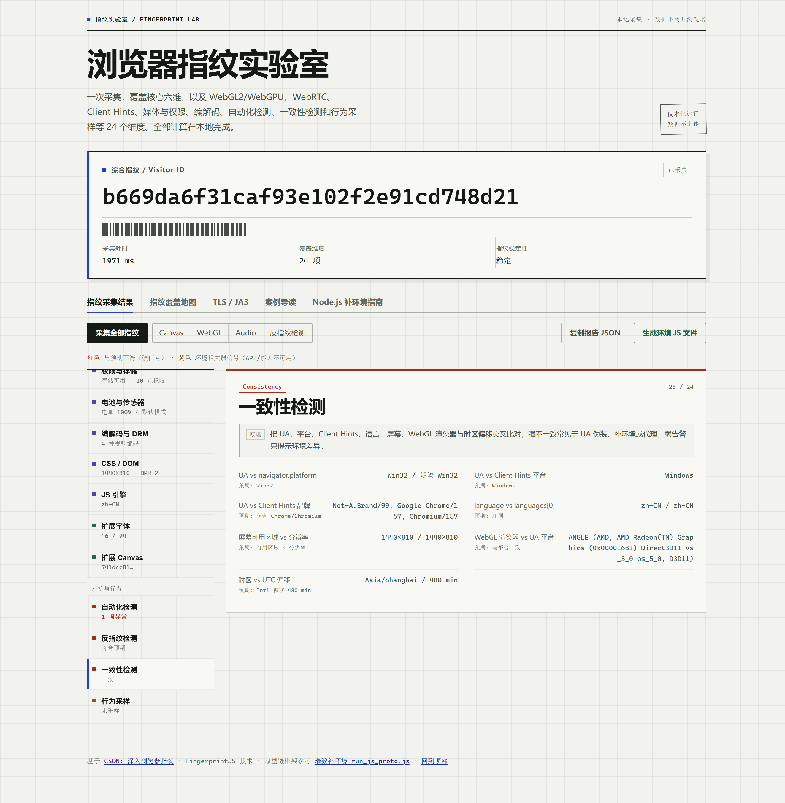

# fingerprint — 浏览器指纹采集与 Node.js 环境复现工具集

[](https://nodejs.org/)
[](LICENSE)
[](https://fingerprint.jimmysmileltl.workers.dev/)
[](README_en.md)

完整复现 **Canvas / WebGL / Audio / 字体 / 硬件 / 时区** 六大浏览器指纹维度，覆盖
「浏览器采集 → Node.js 补环境 → 真实数据注入 → 指纹一致性验证」全流程。

**在线体验**：<https://fingerprint.jimmysmileltl.workers.dev/>

既可以在真实浏览器中一键采集自己的设备指纹，也可以在 Node.js 中把这份报告注入补环境，
让无头环境输出与真实浏览器完全一致的指纹。

## 目录

- [✨ 特性](#-特性)
- [📁 目录结构](#-目录结构)
- [🚀 快速开始](#-快速开始)
- [🧰 API 速览](#-api-速览)
- [📚 实际案例](#-实际案例)
- [🧠 工作原理](#-工作原理)
- [❓ FAQ](#-faq)
- [⚠️ 免责声明](#️-免责声明)
- [License](#license)

## ✨ 特性

- **六大核心维度**（`all_fp.js`）：Canvas（基础 + 高级）、WebGL（硬件参数 + 着色器像素）、
  Audio、字体、硬件、时区，浏览器与 Node.js 双环境通用
- **25 个维度全面覆盖**：核心六维 + WebGL2/WebGPU、WebRTC、Client Hints、插件/扩展、媒体/语音、
  权限/存储、电池/传感器、编解码/DRM、CSS/DOM、JS 引擎、扩展字体/Canvas、自动化检测、一致性检测、行为采样
- **可视化采集页面**（`test_fp.html`）：浏览器打开 → 自动采集 → 分组维度导航 → 一键复制/下载报告
- **维度导航 + 丰富原理**：每个维度包含多段技术原理与「怎么读」要点；「指纹覆盖地图」说明 L1–L6 分层与边界
- **案例导读**：19 个案例按 L1–L6 分组，卡片给出「机制 / 排查 / 本项目对应」，并链接到完整案例目录
- **TLS / JA3 记录**：Workers 边缘 `/api/tls` 返回 TLS 版本/套件/HTTP 协议；本地
  `tools/tls_ja3_capture.py` 纯标准库捕获 ClientHello，输出 JA3 / JA3 hash
- **原型链级补环境**（`fp_env_patch.js`）：`instanceof`、`toString`、getter 全对齐真实浏览器，
  遵循「真实数据优先，合成数据兜底」原则
- **真实报告一键注入**：`injectRealFingerprint(report)` 自动解析报告并注入全部维度
- **设备预设 / 环境变量**：`--preset macos-chrome` 或 `FP_GPU_VENDOR=...` 快速切换设备画像
- **静态部署就绪**：`npm run build:pages` 生成自包含 `dist/`（md5 已本地化），可直接发布到
  Cloudflare Pages 等静态托管
- **自包含案例**：`cases/` 目录提供可运行的实际案例

## 📁 目录结构

```
fingerprint/
├── all_fp.js                # 核心指纹采集（ES Module，浏览器 & Node 双环境）
├── supplemental_fp.js       # 扩展环境指纹（WebGL2/WebGPU/WebRTC/Client Hints/媒体/权限等）
├── fp_env_patch.js          # Node.js 补环境（Canvas/WebGL/Audio 原型链 + 注入通道）
├── fp_env_ruishu_plus.js    # 瑞数增强环境（研究示例，见免责声明）
├── test_fp.html             # 浏览器采集页（维度导航 + 覆盖地图 + 案例导读 + 报告导出）
├── test_fp_node.js          # Node.js 冒烟测试（--preset 切换设备画像）
├── test_e2e_ruishu.py       # 瑞数 WAF 端到端研究脚本（Python）
├── index.js                 # 早期浏览器 demo（依赖 fingerprintjs2 CDN）
├── core/                    # 各维度独立模块（canvasFP/webglFP/audioFP/netFP）
├── cases/                   # 实际案例（每个案例一个目录）
├── vendor/                  # 本地化的 blueimp-md5（在线体验不再依赖 CDN）
├── worker/index.js          # Workers 入口：静态资源 + /api/tls 边缘 TLS 元数据
├── tools/tls_ja3_capture.py # 本地 ClientHello 捕获 → JA3 / JA3 hash（纯标准库）
├── tools/tls_probe.py       # 触发 requests / curl_cffi 的 ClientHello
├── scripts/build-pages.mjs  # 静态托管构建脚本（生成 dist/）
├── deploy/_headers          # Cloudflare 响应头
├── deploy/robots.txt        # 爬虫规则
├── deploy/sitemap.xml       # 站点地图（canonical /）
├── docs/og-image.png        # 1200×630 社交预览图
├── docs/og-card.html        # OG 卡片源文件（可重新截图）
├── wrangler.toml            # Workers 静态资源（npx wrangler deploy）
└── wrangler.pages.toml      # Pages 命令行部署（可选）
```

## 🚀 快速开始

### 1. 浏览器采集（拿真实指纹）

```bash
# 在本目录起一个静态服务
python -m http.server 8080
# 打开 http://localhost:8080/test_fp.html
# 等待自动采集完成 → 点击「生成环境 JS 文件」→「复制报告 JSON」
# 保存为 browser_fingerprint.json（已加入 .gitignore，请勿提交）
```



### 2. Node.js 验证

```bash
npm install            # 仅需 blueimp-md5
node test_fp_node.js   # 全维度冒烟测试

# 切换设备画像
node test_fp_node.js --preset macos-chrome
# 或环境变量
FP_GPU_VENDOR="NVIDIA" FP_GPU_RENDERER="RTX 4090" node test_fp_node.js
```

### 3. 注入真实报告

```javascript
const { injectRealFingerprint } = require('./fp_env_patch.js');
const report = require('./browser_fingerprint.json');
injectRealFingerprint(report);          // 自动解析并注入全部维度

const mod = await import('./all_fp.js');
const fp = new mod.BrowserFingerprinter();
const result = await fp.getFingerprint();
// result.visitorId 应与浏览器端报告一致
```

> 💡 完整可运行示例见 `cases/01_parity_demo/`。

## 🧰 API 速览

### all_fp.js（指纹采集，ES Module）

| 分类 | 导出 | 说明 |
|------|------|------|
| 工具 | `hashString` / `md5Hash` | 字符串哈希 / MD5 |
| Canvas | `getCanvasFingerprint()` | 基础画布指纹（200x50） |
| | `getCanvasFingerprintAdvanced()` | 高级画布指纹（280x60，含 Farbling 稳定性检测） |
| WebGL | `getWebGLContext()` | 获取 WebGL 上下文 |
| | `getWebGLFingerprint()` | GPU 硬件参数（厂商/渲染器/上限/扩展） |
| | `getAdvancedWebGLFingerprint()` | 着色器像素级指纹 |
| Audio | `getAudioFingerprint(timeoutMs)` | 音频渲染波形指纹（异步） |
| 字体 | `getFontFingerprint(testFonts?)` | 已安装字体检测（16 字体候选） |
| 硬件 | `getHardwareFingerprint()` | CPU 核心/内存/触点数/平台 |
| 时区 | `getTimezoneFingerprint()` | 时区 + 偏移 + 语言 |
| 检测 | `detectCanvasFarbling()` | Canvas 噪声检测（Brave 类） |
| | `detectWebGLInterception()` | GPU 信息拦截检测 |
| | `detectUAReduction()` | UA 缩减检测 |
| 综合 | `BrowserFingerprinter`（class） | `.getComponents()` / `.getFingerprint()`（→ `{visitorId, components}`）/ `.getShortFingerprint()` |
| | `BrowserFP` | FingerprintJS 兼容接口：`.load()` / `.getVisitorId()` |

### fp_env_patch.js（Node 补环境，CommonJS）

| 导出 | 说明 |
|------|------|
| `setFingerprintConfig({...})` | 覆盖任意指纹配置项 |
| `injectRealFingerprint(report)` | 一键注入 test_fp.html 采集的报告 |
| `applyPreset(name)` / `PRESETS` | 设备画像预设：`windows-chrome` / `macos-chrome` / `linux-chrome` / `ios-safari` |
| `FP_CONFIG` | 当前配置对象（六大维度 + 注入槽位） |
| `updateFunToString` / `setNativeTag` / `defProp` | 原型链 / toString 伪装工具 |
| `Window` / `Navigator` / `Document` / `HTMLCanvasElement` / `WebGLRenderingContext` / `OfflineAudioContext` … | 环境构造函数（供外部扩展） |

### supplemental_fp.js（扩展指纹，浏览器专用）

`collectSupplementalFingerprint()` 返回：

| 字段 | 内容 |
|------|------|
| `clientHints` | UA-CH 品牌/平台/架构/版本 |
| `webgl2` / `webgpu` | 图形上限、扩展、adapter 信息 |
| `webrtc` | ICE 候选类型与地址 |
| `mediaDevices` / `speech` | 媒体设备数量、TTS 语音列表 |
| `permissionsStorage` / `batterySensors` | 权限、配额、电池、传感器、手柄 |
| `codecsDrm` / `cssDom` / `jsEngine` | 编解码与 DRM、媒体查询、JS 引擎怪癖 |
| `fontsExpanded` / `canvasExtra` | 94 候选字体、额外 Canvas 渲染 |
| `automation` | webdriver / CDP / Headless 线索 |

> 这些结果不进入 core `visitorId`；`test_fp.html` 将它们作为独立维度展示。复制报告会包含
> `supplemental`；生成 Node 环境 JS 时只使用 core `components`（Node 侧没有这些浏览器 API）。
> 行为采样在页面内完成，仅统计数量与速度，不记录按键内容或坐标明细。

## 📚 实际案例

见 [`cases/`](cases/README.md)——案例库以**辅助理解**为定位，配套：

- **反爬分层模型**：把反爬看成六层塔（传输 → 挑战 → 环境 → 签名 → 行为 → 合规），每个案例标了所属层级
- **现象速查表**：遇到 403/412/405/521/签名参数/滑块……直接查该看哪个案例
- **阅读路线**：新手路线 / 指纹主线 / WAF 主线 / 签名主线 / 行为与合规
- **术语速查**：JA3、JSVMP、补环境、纯算、魔改哈希、风控联动等

案例总览：

| # | 案例 | 类型 | 说明 |
|---|------|------|------|
| 1 | `cases/01_parity_demo` | 🔧 可运行 | 报告注入 → Node 输出与浏览器一致性验证（自包含，无需目标站点） |
| 2 | `cases/02_ruishu_caict` | 🔧 可运行 | 瑞数 WAF 端到端研究流程（412 → 补环境 → cookie → 验证） |
| 3 | `cases/03_akamai_bot_manager` | 📖 文档 | Akamai sensor_data / _abck 风控 + TLS 指纹 |
| 4 | `cases/04_jd_h5st` | 📖 文档 | 京东 h5st 动态签名（魔改哈希 + 字节码 VM + 环境指纹） |
| 5 | `cases/05_boss_zhipin` | 📖 文档 | BOSS 直聘 __zp_stoken__ 动态令牌 + Canvas 指纹 |
| 6 | `cases/06_device_sdk` | 📖 文档 | 国内风控设备指纹 SDK 采集面（数美/顶象/极验） |
| 7 | `cases/07_cloudflare` | 📖 文档 | Cloudflare TLS 指纹 + Turnstile 隐形验证 |
| 8 | `cases/08_tls_fingerprint` | 🔧 可运行 | TLS 指纹：requests 拿不到、curl_cffi 能拿到（北大信研院实战 + 对比脚本） |
| 9 | `cases/09_behavioral` | 📖 文档 | 行为/轨迹指纹：极验/顶象滑块轨迹「行为即验证」 |
| 10 | `cases/10_webrtc` | 📖 文档 | WebRTC 指纹：代理下真实 IP 泄露（STUN/mDNS/IPv6） |
| 11 | `cases/11_automation_detection` | 📖 文档 | 自动化检测：webdriver 标记、CDP 暴露与 stealth 对抗 |
| 12 | `cases/12_font` | 📖 文档 | 字体反爬（字形映射）+ 字体指纹（安装列表） |
| 13 | `cases/13_aws_waf` | 📖 文档 | AWS WAF Bot Control：405 挑战 + 视觉验证码 |
| 14 | `cases/14_jiasule_521` | 📖 文档 | 加速乐 521：双层挑战 + Cookie 增量语义 |
| 15 | `cases/15_douyin_a_bogus` | 📖 文档 | 抖音 a_bogus 动态签名 |
| 16 | `cases/16_xiaohongshu_xs` | 📖 文档 | 小红书 x-s/shield 签名族 |
| 17 | `cases/17_zhihu_x_zse_96` | 📖 文档 | 知乎 x-zse-96 签名 |
| 18 | `cases/18_netease_weapi` | 📖 文档 | 网易云 weapi 两段式接口加密 |
| 19 | `cases/19_compliance` | 📖 合规 | 爬虫司法判例与合法边界 |

## 🧠 工作原理

### 六大维度

| 维度 | 原理 | 注入字段 |
|------|------|---------|
| Canvas | 不同系统的字体渲染/抗锯齿/颜色空间差异 → `toDataURL` 字节级不同 | `canvasDataURL` / `canvasDataURLAdvanced` |
| WebGL | GPU 型号、驱动、着色器浮点精度差异 | `webglVendorRaw` / `webglRendererRaw` / `webglShaderPixelsRaw` / `gpuMaxViewportDims` 等 |
| Audio | 音频栈与浮点精度差异 → 波形采样点不同 | `audioRawSamples` |
| 字体 | 已安装字体集合 + 渲染宽度差异 | `fontWidthsRaw`（字体名 → 宽度映射） |
| 硬件 | CPU 核心数 / 内存 / 触点数 / 平台 | `hardwareConcurrency` / `deviceMemory` / `platform` 等 |
| 时区 | IANA 时区 + UTC 偏移 + 语言列表 | `timezone` / `timezoneOffset` / `languages` |

### 补环境方法论（5 阶段）

1. **枚举 API** — 静态搜索目标脚本用到的浏览器 API
2. **全局骨架** — `window = global` + 原型链挂载，清理 Node 痕迹
3. **逐维度补实现** — 每个指纹维度「真实数据优先，合成数据兜底」
4. **toString 伪装** — `Function.prototype.toString` 劫持，返回 `[native code]`
5. **验证** — 浏览器 vs Node 逐项对比（`test_fp_node.js`）

## 🧩 扩展指纹覆盖（25 个维度）

页面采集结果按三组展示；**扩展项不进入 core visitorId**，避免破坏浏览器 ↔ Node 的一致性。

| 分组 | 维度 | 主要读数 |
|------|------|---------|
| 核心指纹 | Canvas / WebGL / Audio / 字体 / 硬件 / 时区 | 像素哈希、GPU 参数、波形采样、字体列表、CPU/RAM、IANA 时区 |
| 扩展环境 | 环境补充 / Client Hints / WebGL2 / WebGPU | UA、屏幕、DPR、网络信息；UA-CH 高熵值；GPU 上限/adapter |
| 扩展环境 | 插件与扩展 | `navigator.plugins` / MIME 与指纹；只有内置 PDF 插件，**扩展列表不可枚举**（已知扩展探测需预置 ID + WAR） |
| 扩展环境 | WebRTC / 媒体设备 / 语音合成 | ICE 候选与类型；摄像头/麦克风/扬声器数量；TTS 语音列表 |
| 扩展环境 | 权限与存储 / 电池与传感器 | Permissions 状态、配额、localStorage；电量、传感器构造器、手柄 |
| 扩展环境 | 编解码与 DRM / CSS·DOM / JS 引擎 | H.264/HEVC/AV1、Widevine/PlayReady；媒体查询、CSS.supports；Math/Intl/错误栈 |
| 扩展环境 | 扩展字体 / 扩展 Canvas | 94 个候选字体的安装列表；渐变文字、emoji、混合模式、evenodd 画布 |
| 对抗与行为 | 反指纹检测 / 自动化检测 / 一致性检测 | Farbling、WebGL 拦截、UA 精简；webdriver、CDP 标记、Headless UA；UA vs CH/平台/时区交叉校验 |
| 对抗与行为 | 行为采样 | 指针轨迹长度、平均/峰值速度、点击、按键、触摸、滚动（仅本地统计） |

**插件 / 扩展维度的缺陷**：网页只能拿到 `navigator.plugins` / `mimeTypes`，它暴露的是浏览器内置的
PDF 等老式插件，**不是已安装的扩展**。扩展没有标准 Web API 可枚举；已知扩展探测依赖扩展声明的
Web Accessible Resources，仅适用于部分 Chromium 扩展，MV3 的动态 URL、禁用状态和 Firefox 的
按 profile 随机 ID 都会导致漏报。因此本维度只做低熵辅助指纹，不参与 `visitorId`，也不做扩展探测。

检测类维度（自动化检测、反指纹检测、一致性检测、WebGL）会为每行标注**预期值**：
只有明确的强信号（WebDriver、Headless UA、注入/CDC 标记、Farbling 等）才**红色**高亮并计入导航异常数；
浏览器能力、隐私设置等环境差异——如无法读取 Unmasked GPU 信息、软件渲染——只做**黄色**弱提示，不代表自动化。
窗口 `outer/inner` 尺寸受页面缩放、DPI、全屏与 DevTools 影响（常见现象是 `inner > outer`），**仅展示，不参与判定**。

**电池指纹**：`Battery Status API` 的电量、充电中、充电时间、放电时间也是站点常见的环境信号。
电量超出 `0–100%`、时间为负或 NaN 会红色告警；`充电中 / 100% / 充电 0s / 放电 ∞` 是插电台式机
常见值，也是部分虚拟机/headless 的默认值，因此只做黄色弱提示。

### 边界（不是“遗漏”，是采集位置不同）

- **TLS / JA3 / JA4**：握手阶段信号，由 Workers 边缘 API 或本地 ClientHello 工具记录，不在浏览器环境层
- **TTL / HTTP/2 帧 / DNS**：IP/TCP 或协议栈信号，需要抓包或自定义服务端；JS 读不到
- **设备 SDK / App native / 滑块轨迹**：需要 SDK 逆向或行为采集，仓库用案例 06/09/16 说明
- **WAF 挑战 / 签名参数**：属 L2/L4，仓库用案例文档而非在线采集器覆盖

> 浏览器指纹是开放集合，不存在“绝对全面”。本项目的原则是：**能由浏览器读到的尽量采集并解释；读不到的明确标注边界和替代工具**。

## 🔐 TLS / JA3 记录

浏览器 JavaScript 读不到 TLS 握手，所以 TLS 指纹分两条路记录：

### 1. Workers 边缘元数据（在线）

部署到 Cloudflare Workers 后，`/api/tls` 返回本次连接的：

`tlsVersion` / `tlsCipher` / `httpProtocol` / `clientTcpRtt` / `asn` / `colo` / `country`

若开通 **Cloudflare Bot Management**，还会返回 `ja3Hash` / `ja4`；否则 JA3/JA4 需要下面的本地捕获工具。

### 2. 本地 ClientHello 捕获（完整 JA3）

工具只读取 ClientHello，不完成 TLS 握手，因此不需要证书或抓包驱动：

```bash
# 终端 A：启动捕获（默认 127.0.0.1:8443）
python tools/tls_ja3_capture.py --port 8443

# 终端 B：触发要测的客户端
python tools/tls_probe.py --client curl_cffi --impersonate chrome110
python tools/tls_probe.py --client requests
curl -k https://127.0.0.1:8443
```

终端 A 会打印 JA3 字符串与 hash：

```text
[JA3] 042a49f01cd801200137ec52ff0018fc
      ja3: 771,4865-4866-...,23-5-10-...,29-23-24,0
      sni: example.com | alpn: h2,http/1.1 | versions: TLS1.3,TLS1.2
```

- `requests` 与 `curl_cffi` 的 JA3 hash 通常不同，可用于验证 TLS 伪装是否生效
- **Chrome 会随机化 ClientHello 扩展顺序**，同一台 Chrome 的 JA3 也可能每次不同；需要稳定比对时优先看 JA4，或使用 curl_cffi 这类固定指纹客户端
- 本工具输出**客户端 JA3**；JA3S（服务端）与 JA4 的计算规则不同，未包含在内
- Windows 下如果没有 `python` 命令，用 `py` 替代（例如 `py tools/tls_ja3_capture.py --port 8443`）
- 对照案例：`cases/08_tls_fingerprint/`

### 参考资料

- [JA3 指纹介绍与实现（tr0y.wang）](https://www.tr0y.wang/2020/06/28/ja3/)
- [CSDN：JA3 / TLS 指纹相关文章](https://blog.csdn.net/qq_38223858/article/details/145692676)
- [Salesforce JA3 规范与实现](https://github.com/salesforce/ja3)

## ☁️ 部署在线体验（Cloudflare）

当前线上示例：<https://fingerprint.jimmysmileltl.workers.dev/>（Cloudflare Workers）。

采集页是纯静态页面，`vendor/blueimp-md5` 已本地化，不依赖运行时 CDN。

> ⚠️ **Root directory 必须是仓库根目录 `/`，不能填 `dist`。**
> `dist/` 是构建产物，克隆仓库时还不存在；把 Root directory 设成 `dist` 会直接报
> `Failed: root directory not found`。

### 方式 A：Workers Builds（控制台字段：Build command / Deploy command / Root directory）

这是 Cloudflare 新版 Workers & Pages 的 Git 集成界面。填写：

| 配置 | 值 |
|------|-----|
| Root directory | `/`（仓库根目录） |
| Build command | `npm run build:pages` |
| Deploy command | `npx wrangler deploy` |

`wrangler.toml` 已配置 Workers 静态资源：

```toml
name = "fingerprint"       # 改成控制台里的 Worker 名
compatibility_date = "2026-11-15"

[assets]
directory = "./dist"
```

构建流程：克隆仓库 → `npm run build:pages` 生成 `dist/` → `npx wrangler deploy` 上传静态资源。

### 方式 B：Cloudflare Pages Git 集成

在 Pages 里连接仓库，填写：

| 配置 | 值 |
|------|-----|
| Framework preset | None |
| Root directory | `/` |
| Build command | `npm run build:pages` |
| Build output directory | `dist` |

Pages 不需要 Deploy command；构建完成后自动发布 `dist/`。部署后的根路径 `/` 即 `dist/index.html`。

### 方式 C：命令行直接上传

```bash
# Workers（使用 wrangler.toml）
npm run build:pages
npx wrangler deploy

# 或 Pages（使用 wrangler.pages.toml）
npm run build:pages
npx wrangler pages project create fingerprint   # 首次创建
npx wrangler pages deploy dist --project-name fingerprint --config wrangler.pages.toml
```

- `deploy/_headers` 会随构建复制，提供 `nosniff` / `Referrer-Policy` / 权限策略，以及 `vendor/` 长缓存
- 国内访问：`*.pages.dev` / `*.workers.dev` 一般可访问；自定义域名按 Cloudflare 流程绑定。大陆节点加速通常需要企业版中国网络，普通免费计划使用全球 CDN
- 构建产物只包含采集页、JS 依赖、SEO 静态文件与 `vendor/`；`test_e2e_ruishu.py` 等研究脚本不会被上传为可执行接口

### SEO（已内置）

- 标题、description、canonical、Open Graph / Twitter Card 与 `max-image-preview:large`
- JSON-LD：`WebApplication` + `FAQPage`（页面底部有可见的“关于 / 常见问题”内容）
- `/robots.txt` 与 `/sitemap.xml` 随构建复制；`/og-image.png` 为 1200×630 社交预览图
- 根路径 `/` 是唯一 sitemap 条目；线上 `/test_fp.html` 会 301 到 `/`，且页面共用 canonical，避免重复收录
- 部署后建议在 Google Search Console / Bing Webmaster Tools 提交
  `https://fingerprint.jimmysmileltl.workers.dev/sitemap.xml`，并验证域名

## ❓ FAQ

**Q: 运行时出现 `MODULE_TYPELESS_PACKAGE_JSON` 警告？**
无害。`all_fp.js` 是 ES Module 但仓库 `package.json` 没有声明 `"type": "module"`
（声明了会让 CommonJS 的 `fp_env_patch.js` 失效），Node 靠语法探测自动识别，只是顺手警告。
想消除它：把 `all_fp.js` 复制为 `all_fp.mjs` 并改 import 路径即可，不复制也不影响任何功能。

**Q: 在页面里引入 `all_fp.js` 会自动跑测试并往页面追加输出吗？**
默认会（方便单独打开时自检）。宿主页面可在 import 之前设置 `window.__FP_NO_AUTORUN = true`，
关闭自动测试与 DOM 输出——`test_fp.html` 就是这么做的。

**Q: Node 版本要求？**
推荐 **Node 22+**（默认开启 ESM 语法探测）。20.x 需加 `--experimental-detect-module` 标志。

**Q: Python 脚本的依赖？**
```bash
pip install -r requirements.txt   # requests + curl_cffi
```

**Q: test_fp.html 必须起服务吗？**
是的。页面使用 ES module + import map；虽然 `blueimp-md5` 已本地化到 `vendor/`，`file://`
下模块请求仍会被 CORS 拦截：先 `python -m http.server 8080`，再访问
`http://localhost:8080/test_fp.html`。

**Q: 真实浏览器报告可以提交吗？**
不要。`browser_fingerprint.json` 已加入 `.gitignore`——它含你设备的真实指纹。

## ⚠️ 免责声明

本项目仅供**学习与研究**浏览器指纹技术、Web 安全与逆向工程使用。

- 请勿将本项目用于任何非法用途、未授权的系统访问，或违反目标网站服务条款的爬取行为
- `test_e2e_ruishu.py` / `fp_env_ruishu_plus.js` 演示的是瑞数 WAF 的通用挑战-响应流程，
  目标站点仅作为公开演示对象，请遵守相关法律法规
- 使用者需对自身行为承担全部责任

## License

[MIT](LICENSE) © 2026 JimmySmile
