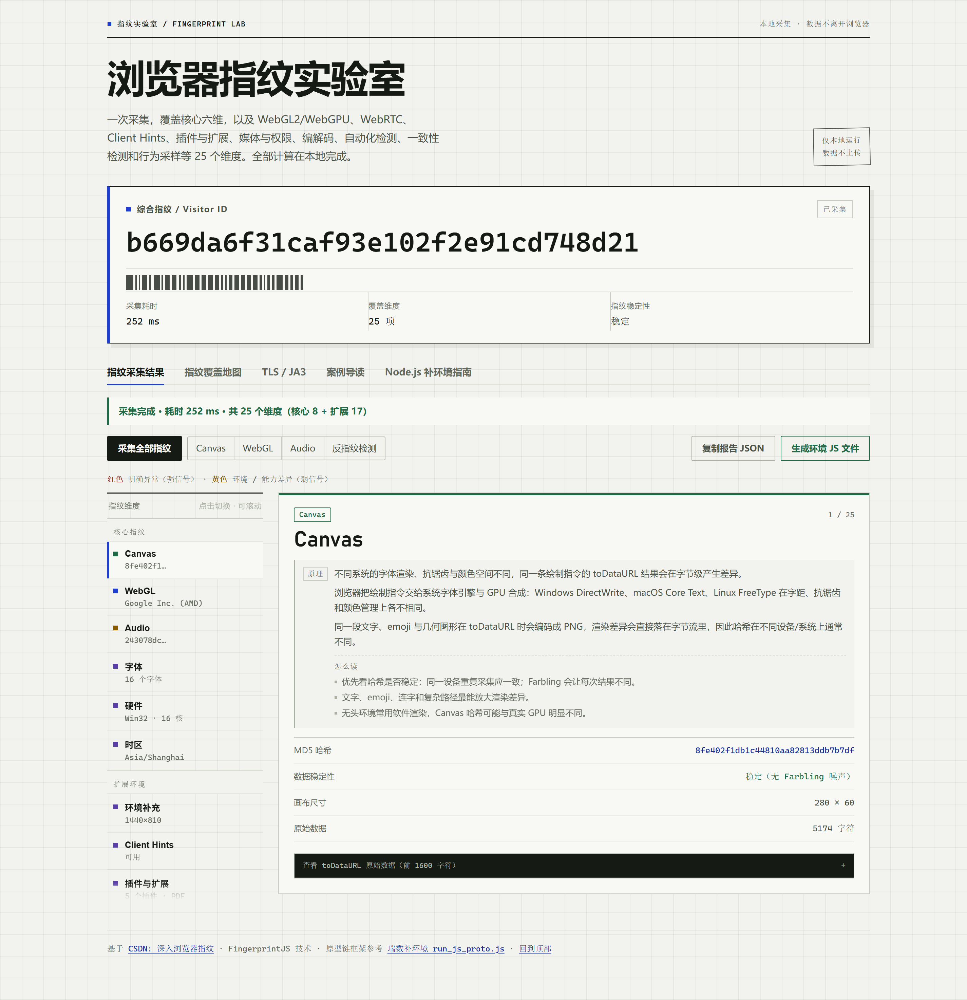

# fingerprint — Browser Fingerprint Collection & Node.js Environment Emulation

[](https://nodejs.org/)
[](LICENSE)
[](https://fingerprint.jimmysmileltl.workers.dev/)
[](README.md)

A toolkit that fully reproduces the six major browser fingerprint dimensions — **Canvas / WebGL / Audio / Fonts / Hardware / Timezone** —
covering the complete pipeline: *browser collection → Node.js environment patch → real data injection → parity verification*.

**Live demo**: <https://fingerprint.jimmysmileltl.workers.dev/>

Collect your real device fingerprint in a browser with one click, then inject that report into the Node.js environment
so headless code emits a fingerprint identical to your real browser.

## Table of Contents

- [Features](#features)
- [Structure](#structure)
- [Quick Start](#quick-start)
- [API Overview](#api-overview)
- [Real-World Cases](#real-world-cases)
- [How It Works](#how-it-works)
- [FAQ](#faq)
- [Disclaimer](#disclaimer)
- [License](#license)

## Features

- **Six core dimensions** (`all_fp.js`): Canvas (basic + advanced), WebGL (hardware params + shader pixels),
  Audio, Fonts, Hardware, Timezone — works in both browser and Node.js
- **25-dimension coverage**: core six plus WebGL2/WebGPU, WebRTC, Client Hints, plugins/extensions,
  media/voice, permissions/storage, battery/sensors, codecs/DRM, CSS/DOM, JS engine,
  expanded fonts/Canvas, automation markers, consistency checks and behavior sampling
- **Visual collection page** (`test_fp.html`): open in browser → auto-collect → grouped dimension nav →
  one-click copy/download of the report
- **Dimension nav + rich explanations**: each dimension includes multi-paragraph principles and "how to read it" notes; a coverage map documents the L1–L6 layers
- **Case guide**: 19 cases grouped by L1–L6, each card summarizing mechanism / diagnosis / tooling, with links to the full case README
- **TLS / JA3 recording**: the Workers `/api/tls` endpoint returns TLS version/cipher/HTTP protocol;
  `tools/tls_ja3_capture.py` captures ClientHello locally (stdlib only) and prints JA3 / JA3 hash
- **Prototype-chain-level env patch** (`fp_env_patch.js`): `instanceof`, `toString` and getters all align with a real browser;
  follows the "real data first, synthetic fallback" principle
- **One-click report injection**: `injectRealFingerprint(report)` parses and injects every dimension automatically
- **Device presets / env vars**: `--preset macos-chrome` or `FP_GPU_VENDOR=...` for quick device-profile switching
- **Static-deploy ready**: `npm run build:pages` produces a self-contained `dist/` (vendored md5) for Cloudflare Pages
  or any static host
- **Self-contained cases**: runnable real-world examples under `cases/`

## Structure

```
fingerprint/
├── all_fp.js                # Core fingerprint collection (ES module, browser & Node)
├── supplemental_fp.js       # Supplemental environment signals (WebGL2/WebGPU/WebRTC/CH/media/...)
├── fp_env_patch.js          # Node.js environment patch (Canvas/WebGL/Audio prototype chains + injection)
├── fp_env_ruishu_plus.js    # Enhanced Ruishu environment (research example, see Disclaimer)
├── test_fp.html             # Browser collection page (dimension nav + coverage map + case guide + report export)
├── test_fp_node.js          # Node.js smoke test (--preset to switch device profiles)
├── test_e2e_ruishu.py       # Ruishu WAF end-to-end research script (Python)
├── index.js                 # Legacy browser demo (depends on fingerprintjs2 CDN)
├── core/                    # Per-dimension standalone modules (canvasFP/webglFP/audioFP/netFP)
├── cases/                   # Real-world cases (one directory per case)
├── vendor/                  # Vendored blueimp-md5 (no runtime CDN dependency)
├── worker/index.js          # Workers entry: static assets + /api/tls edge metadata
├── tools/tls_ja3_capture.py # Local ClientHello capture → JA3 / JA3 hash (stdlib only)
├── tools/tls_probe.py       # Trigger requests / curl_cffi ClientHello
├── scripts/build-pages.mjs  # Static-host build (produces dist/)
├── deploy/_headers          # Cloudflare response headers
├── wrangler.toml            # Workers static assets (`npx wrangler deploy`)
└── wrangler.pages.toml      # Pages CLI deploy (optional)
```

## Quick Start

### 1. Collect in a real browser

```bash
# Serve the directory
python -m http.server 8080
# Open http://localhost:8080/test_fp.html
# Wait for auto-collection → click "Generate env JS" → "Copy report JSON"
# Save it as browser_fingerprint.json (gitignored — do not commit)
```



### 2. Verify in Node.js

```bash
npm install            # only needs blueimp-md5
node test_fp_node.js   # full-dimension smoke test

# Switch device profile
node test_fp_node.js --preset macos-chrome
# Or via env vars
FP_GPU_VENDOR="NVIDIA" FP_GPU_RENDERER="RTX 4090" node test_fp_node.js
```

### 3. Inject the real report

```javascript
const { injectRealFingerprint } = require('./fp_env_patch.js');
const report = require('./browser_fingerprint.json');
injectRealFingerprint(report);          // auto-parses and injects every dimension

const mod = await import('./all_fp.js');
const fp = new mod.BrowserFingerprinter();
const result = await fp.getFingerprint();
// result.visitorId should match the browser-side report
```

> 💡 See `cases/01_parity_demo/` for a complete runnable example.

## API Overview

### all_fp.js (fingerprint collection, ES module)

| Category | Export | Description |
|----------|--------|-------------|
| Utils | `hashString` / `md5Hash` | String hash / MD5 |
| Canvas | `getCanvasFingerprint()` | Basic canvas fingerprint (200x50) |
| | `getCanvasFingerprintAdvanced()` | Advanced canvas fingerprint (280x60, with Farbling stability check) |
| WebGL | `getWebGLContext()` | Get a WebGL context |
| | `getWebGLFingerprint()` | GPU hardware params (vendor/renderer/limits/extensions) |
| | `getAdvancedWebGLFingerprint()` | Shader-pixel-level fingerprint |
| Audio | `getAudioFingerprint(timeoutMs)` | Audio-rendering waveform fingerprint (async) |
| Fonts | `getFontFingerprint(testFonts?)` | Installed-font detection (16 candidates) |
| Hardware | `getHardwareFingerprint()` | CPU cores / RAM / touch points / platform |
| Timezone | `getTimezoneFingerprint()` | Timezone + offset + languages |
| Detection | `detectCanvasFarbling()` | Canvas noise detection (Brave-style) |
| | `detectWebGLInterception()` | GPU info interception detection |
| | `detectUAReduction()` | UA reduction detection |
| Aggregate | `BrowserFingerprinter` (class) | `.getComponents()` / `.getFingerprint()` (→ `{visitorId, components}`) / `.getShortFingerprint()` |
| | `BrowserFP` | FingerprintJS-compatible: `.load()` / `.getVisitorId()` |

### fp_env_patch.js (Node env patch, CommonJS)

| Export | Description |
|--------|-------------|
| `setFingerprintConfig({...})` | Override any fingerprint config item |
| `injectRealFingerprint(report)` | One-shot injection of a report collected by test_fp.html |
| `applyPreset(name)` / `PRESETS` | Device presets: `windows-chrome` / `macos-chrome` / `linux-chrome` / `ios-safari` |
| `FP_CONFIG` | Current config object (six dimensions + injection slots) |
| `updateFunToString` / `setNativeTag` / `defProp` | Prototype-chain / toString camouflage helpers |
| `Window` / `Navigator` / `Document` / `HTMLCanvasElement` / `WebGLRenderingContext` / `OfflineAudioContext` … | Environment constructors (for external extension) |

### supplemental_fp.js (browser-only)

`collectSupplementalFingerprint()` returns `clientHints`, `webgl2`, `webgpu`, `webrtc`,
`mediaDevices`, `speech`, `permissionsStorage`, `batterySensors`, `codecsDrm`, `cssDom`,
`jsEngine`, `fontsExpanded`, `canvasExtra` and `automation`. These signals are displayed as
separate dimensions and intentionally excluded from the core `visitorId`. The copied report includes
`supplemental`; the generated Node environment uses only core `components` (Node has no such browser
APIs). Behavior sampling stores only counts/timing locally — no key contents or coordinates.

## Real-World Cases

See [`cases/`](cases/README.md) — the case library is built to aid understanding, with:

- **Layered defense model**: anti-bot as a six-layer tower (transport → challenge → environment → signature → behavior → compliance)
- **Symptom lookup table**: hit a 403/412/405/521/signature param/captcha? Look up which case explains it
- **Reading paths**: beginner path / fingerprint mainline / WAF mainline / signature mainline / behavior & compliance
- **Glossary**: JA3, JSVMP, env patching, pure algorithm, patched hashes, risk-score linkage, and more

Case overview:

| # | Case | Type | Description |
|---|------|------|-------------|
| 1 | `cases/01_parity_demo` | 🔧 runnable | Report injection → browser/Node parity verification (self-contained) |
| 2 | `cases/02_ruishu_caict` | 🔧 runnable | Ruishu WAF end-to-end research flow (412 → env patch → cookie → verification) |
| 3 | `cases/03_akamai_bot_manager` | 📖 doc | Akamai sensor_data / _abck risk control + TLS fingerprinting |
| 4 | `cases/04_jd_h5st` | 📖 doc | JD.com h5st dynamic signature (patched hash + bytecode VM + env fingerprint) |
| 5 | `cases/05_boss_zhipin` | 📖 doc | BOSS Zhipin __zp_stoken__ dynamic token + Canvas fingerprint |
| 6 | `cases/06_device_sdk` | 📖 doc | Chinese risk-control device-fingerprint SDKs (Shumei / Dingxiang / GeeTest) |
| 7 | `cases/07_cloudflare` | 📖 doc | Cloudflare TLS fingerprinting + Turnstile invisible challenge |
| 8 | `cases/08_tls_fingerprint` | 🔧 runnable | TLS fingerprinting: requests fails, curl_cffi works (real projects + comparison script) |
| 9 | `cases/09_behavioral` | 📖 doc | Behavioral/trajectory fingerprints: GeeTest/Dingxiang slider "behavior as verification" |
| 10 | `cases/10_webrtc` | 📖 doc | WebRTC fingerprint: real-IP leak behind proxies (STUN/mDNS/IPv6) |
| 11 | `cases/11_automation_detection` | 📖 doc | Automation detection: webdriver flag, CDP exposure and stealth countermeasures |
| 12 | `cases/12_font` | 📖 doc | Font anti-crawl (glyph mapping) + font fingerprint (installed-font list) |
| 13 | `cases/13_aws_waf` | 📖 doc | AWS WAF Bot Control: 405 challenge + visual captcha |
| 14 | `cases/14_jiasule_521` | 📖 doc | Jiasule CDN 521: double challenge + incremental cookie semantics |
| 15 | `cases/15_douyin_a_bogus` | 📖 doc | Douyin a_bogus dynamic signature |
| 16 | `cases/16_xiaohongshu_xs` | 📖 doc | Xiaohongshu x-s/shield signature family |
| 17 | `cases/17_zhihu_x_zse_96` | 📖 doc | Zhihu x-zse-96 signature |
| 18 | `cases/18_netease_weapi` | 📖 doc | NetEase weapi two-stage request encryption |
| 19 | `cases/19_compliance` | 📖 compliance | Crawler legal precedents and boundaries |

## How It Works

### The six dimensions

| Dimension | Principle | Injection fields |
|-----------|-----------|------------------|
| Canvas | Font rendering / anti-aliasing / color-space differences across OSes → byte-level differences in `toDataURL` | `canvasDataURL` / `canvasDataURLAdvanced` |
| WebGL | GPU model, driver and shader floating-point precision differences | `webglVendorRaw` / `webglRendererRaw` / `webglShaderPixelsRaw` / `gpuMaxViewportDims` etc. |
| Audio | Audio-stack and float-precision differences → different waveform samples | `audioRawSamples` |
| Fonts | Installed-font set + rendering width differences | `fontWidthsRaw` (font name → width map) |
| Hardware | CPU cores / RAM / touch points / platform | `hardwareConcurrency` / `deviceMemory` / `platform` etc. |
| Timezone | IANA timezone + UTC offset + language list | `timezone` / `timezoneOffset` / `languages` |

### Environment-patch methodology (5 phases)

1. **Enumerate APIs** — statically search the target script for every browser API it touches
2. **Global skeleton** — `window = global` with prototype chains, wipe Node traces
3. **Patch per dimension** — "real data first, synthetic fallback" for every dimension
4. **toString camouflage** — hijack `Function.prototype.toString` to return `[native code]`
5. **Verify** — browser vs Node comparison, dimension by dimension (`test_fp_node.js`)

## Expanded fingerprint coverage (25 dimensions)

Results are grouped in the UI. Supplemental signals are deliberately **not** part of the core
`visitorId`, so the browser ↔ Node parity demo remains stable.

| Group | Dimensions |
|-------|------------|
| Core | Canvas / WebGL / Audio / Fonts / Hardware / Timezone |
| Environment | UA-screen-DPR-network supplement, Client Hints, WebGL2, WebGPU |
| Environment | legacy plugins / MIME types and their hash; only built-in PDF plugins — **installed extensions cannot be enumerated** |
| Environment | WebRTC ICE, media devices, speech voices, permissions/storage, battery/sensors |
| Environment | codecs/DRM, CSS/DOM media features, JS-engine quirks, expanded fonts (94), extra Canvas renders |
| Adversarial | Farbling / WebGL interception / UA reduction, automation markers (webdriver/CDP/Headless), UA-vs-CH/platform/timezone consistency |
| Behavior | local-only pointer path length, average/peak speed, clicks, keys, touches, scrolls |

**Plugin / extension limitation**: `navigator.plugins` and `mimeTypes` expose legacy built-in
plugins (typically PDF readers), not installed extensions. There is no standard web API to enumerate
extensions. Known-extension probing depends on declared Web Accessible Resources, works only for some
Chromium extensions, and misses MV3 dynamic URLs, disabled extensions and Firefox's per-profile IDs.
This dimension is a low-entropy auxiliary fingerprint, is not part of `visitorId`, and does no
extension probing.

Detection dimensions (automation, anti-fingerprinting, consistency, WebGL software rendering)
annotate an **expected value** on every row. Only strong signals (WebDriver, headless UA,
injected/CDC markers, Farbling) highlight a row in red and count toward the nav's anomaly total.
Browser capability and privacy differences — unreadable Unmasked GPU info, software rendering —
are amber hints, not automation evidence. Window `outer/inner` sizes are display-only: page zoom,
DPI, fullscreen and DevTools commonly make `inner > outer`.

**Battery fingerprint**: the Battery Status API exposes level, charging state and charge/discharge
times, which sites commonly use as an environment signal. Levels outside 0–100%, negative or NaN
times are red anomalies; `charging / 100% / charge 0s / discharge ∞` is common on plugged-in
desktops and is also a default in some VMs/headless environments, so it is only an amber hint.

Boundaries (different collection points, not missing features):

- **TLS / JA3 / JA4**: handshake signals — recorded by the Workers `/api/tls` endpoint or the local
  ClientHello capture tool, not by browser JS
- **TTL / HTTP/2 frames / DNS**: network-stack signals — require packet capture or a custom server
- **Device SDK / App native / slider trajectories**: require SDK reverse engineering or behavior
  capture; covered by cases 06/09/16
- **WAF challenges / signature parameters**: L2/L4 concerns — covered by case documentation

Fingerprinting is an open set; the project's rule is to collect and explain what the browser can
read, and to mark the rest with a clear boundary and an alternative tool.

## TLS / JA3 recording

Browser JavaScript cannot read the TLS handshake, so TLS fingerprints are recorded in two ways:

1. **Workers edge metadata**: `/api/tls` returns `tlsVersion`, `tlsCipher`, `httpProtocol`,
   `clientTcpRtt`, `asn`, `colo`, `country`. JA3/JA4 are returned only with Cloudflare Bot Management.
2. **Local ClientHello capture** (full JA3, stdlib only):

```bash
python tools/tls_ja3_capture.py --port 8443
# another terminal:
python tools/tls_probe.py --client curl_cffi --impersonate chrome110
python tools/tls_probe.py --client requests
curl -k https://127.0.0.1:8443
```

The capture server reads ClientHello, prints JA3 and its MD5, then closes the connection; no
certificate or packet-capture driver is required. `requests` and `curl_cffi` normally produce
different JA3 hashes, which makes the tool useful for verifying TLS impersonation. Note that Chrome
randomizes ClientHello extension order, so its own JA3 can vary between connections — prefer JA4
(Bot Management) when you need a stable comparison. The tool records client-side JA3 only; JA3S
(server) and JA4 use different formats.

References:

- [JA3 fingerprint introduction (tr0y.wang)](https://www.tr0y.wang/2020/06/28/ja3/)
- [CSDN: JA3 / TLS fingerprint article](https://blog.csdn.net/qq_38223858/article/details/145692676)
- [Salesforce JA3 specification](https://github.com/salesforce/ja3)

## Deploy the demo (Cloudflare)

Live demo: <https://fingerprint.jimmysmileltl.workers.dev/> (Cloudflare Workers).

The demo is fully static; `vendor/blueimp-md5` is vendored, so there is no runtime CDN dependency.

> ⚠️ **Root directory must be the repository root `/`, never `dist`.**
> `dist/` is generated by the build step and does not exist when the repo is cloned;
> setting Root directory to `dist` fails with `Failed: root directory not found`.

### Option A: Workers Builds (Build command / Deploy command / Root directory)

| Setting | Value |
|---------|-------|
| Root directory | `/` (repository root) |
| Build command | `npm run build:pages` |
| Deploy command | `npx wrangler deploy` |

`wrangler.toml` configures Workers static assets:

```toml
name = "fingerprint"       # match the Worker name in the dashboard
compatibility_date = "2026-11-15"

[assets]
directory = "./dist"
```

### Option B: Cloudflare Pages Git integration

| Setting | Value |
|---------|-------|
| Framework preset | None |
| Root directory | `/` |
| Build command | `npm run build:pages` |
| Build output directory | `dist` |

Pages needs no Deploy command; it publishes `dist/` after the build. The deployed root `/` serves
`dist/index.html`, copied from `test_fp.html` by the build script.

### Option C: Direct upload

```bash
# Workers (uses wrangler.toml)
npm run build:pages
npx wrangler deploy

# or Pages (uses wrangler.pages.toml)
npm run build:pages
npx wrangler pages project create fingerprint   # first time only
npx wrangler pages deploy dist --project-name fingerprint --config wrangler.pages.toml
```

`deploy/_headers` adds `nosniff` / `Referrer-Policy` / permissions policy plus long-lived caching
for `vendor/`. Only the demo page, `all_fp.js` and `vendor/` are deployed; research scripts such as
`test_e2e_ruishu.py` are not exposed as executable endpoints.

## FAQ

**Q: I see a `MODULE_TYPELESS_PACKAGE_JSON` warning at startup. Is it harmful?**
No. `all_fp.js` is an ES module but the repo's `package.json` deliberately declares no `"type"`
(adding `"type": "module"` would break the CommonJS `fp_env_patch.js`), so Node detects the
syntax automatically and prints a notice. To silence it, copy `all_fp.js` to `all_fp.mjs` and
update the import paths — nothing else changes.

**Q: Does importing `all_fp.js` into a page auto-run tests and append output to the DOM?**
Yes, by default (so the module is self-checking when opened alone). A host page can set
`window.__FP_NO_AUTORUN = true` before importing it to disable the auto-run and DOM output —
`test_fp.html` does exactly that.

**Q: Which Node version do I need?**
**Node 22+** is recommended (ESM syntax detection enabled by default). On 20.x, add
`--experimental-detect-module`.

**Q: Python script dependencies?**
```bash
pip install -r requirements.txt   # requests + curl_cffi
```

**Q: Does test_fp.html require a local server?**
Yes. It uses ES modules and an import map; even though `blueimp-md5` is vendored under
`vendor/`, module requests are still blocked under `file://`: run
`python -m http.server 8080` and open `http://localhost:8080/test_fp.html`.

**Q: Can I commit my real browser report?**
No. `browser_fingerprint.json` is gitignored — it contains your device's real fingerprint.

## Disclaimer

This project is intended **solely for studying and researching** browser fingerprinting techniques,
web security, and reverse engineering.

- Do not use it for any illegal purpose, unauthorized access, or crawling that violates a target site's ToS
- `test_e2e_ruishu.py` / `fp_env_ruishu_plus.js` demonstrate the generic challenge-response flow of the
  Ruishu WAF; the target site serves only as a public demonstration object — obey applicable laws
- Users are fully responsible for their own actions

## License

[MIT](LICENSE) © 2026 JimmySmile
